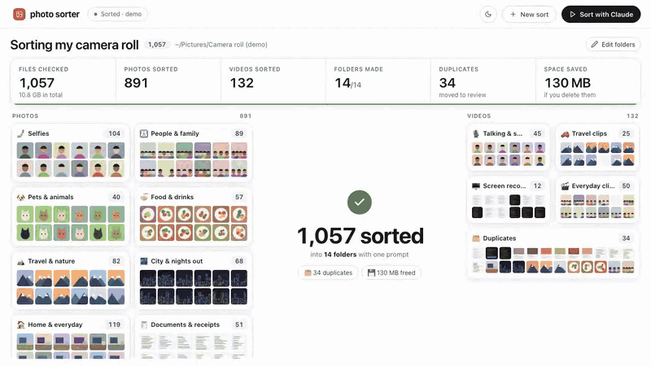

# Claude photo sorter

Point Claude at your camera roll. It looks at every photo and video, sorts them into folders, finds your duplicates, and you watch it happen on a live dashboard on your own laptop.



<sub>The demo above uses drawn placeholder images, not real photos.</sub>

- **Sorts photos and videos** into folders like Selfies, Food, Travel, Screenshots, Talking heads and Screen recordings. Use the standard folders or make your own.
- **Finds duplicates**: identical copies, burst shots and re-saved screenshots go to a `_Review` folder, with a list of which copy was kept.
- **Groups photos by face** (optional, fully on your computer). Finds the people who turn up again and again, shows each as a cropped face you can name, and lets you merge, delete or fix groups right in the dashboard. No faces are ever uploaded.
- **Never touches your originals.** It only reads them and makes sorted copies. On a Mac the copies take no extra space.
- **Runs on your computer.** Your photos are not uploaded anywhere.

## Start here (no coding needed)

You need a Mac and a Claude plan. Windows and Linux work too, with a few less conveniences.

**1. Install Claude Code** from [claude.com/claude-code](https://claude.com/claude-code). Then open the **Terminal** app (press `⌘ Space`, type *Terminal*, press Enter), type `claude` and press Enter.

**2. Paste this to Claude:**

```
Set up and open https://github.com/kartikjindalkj/fuzzy-octo-pancake
```

Claude downloads it, sets it up and opens the dashboard in your browser.

**3. In the dashboard:**

1. **Choose folder**: pick the folder with your photos (a Google Photos or Apple Photos export, or any folder).
2. Pick where the sorted copies should go. The default is right next to your photos.
3. Press **Start sorting**.

It shows how long it usually takes, then sorts on its own while you watch every photo fly into its folder. About 4 minutes for 1,000 photos.

<details>
<summary>Don't have your photos on your computer yet?</summary>

- **Google Photos:** go to [takeout.google.com](https://takeout.google.com), select only Google Photos, download, and unzip everything into one folder.
- **iPhone or Apple Photos:** in Photos on your Mac, select all, then File > Export > Export Unmodified Originals, into a new folder.
</details>

## Using it again

The dashboard lives at **http://127.0.0.1:8765** while it's running. To open it again later, either:

- double-click **Open Photo Sorter.command** in the project folder, or
- tell Claude "open my photo sorter".

It keeps running in the background until you stop it. To stop it, double-click **Stop Photo Sorter.command** (or tell Claude "stop my photo sorter"). Closing the browser tab only hides the page; it does not stop the app.

Press **New sort** to sort a different folder, or send the copies somewhere else.

## The dashboard

| | |
|---|---|
| **Sort with Claude** | Before sorting: asks for anything missing, then starts. After sorting: replays the animation (good for screen recording). Add `?d=20` to the address for a slower take. |
| **New sort** | Pick a new photos folder and a new place for the copies. |
| **Advanced** (in the setup card) | See the folders that will be made, remove any, or press **+** to add your own. Choose Claude or Jev. Try 200 photos first. |
| **Group by faces** / **People** | Groups photos by the people in them, on your computer. Each person shows as a cropped face: name them, merge two groups that are the same person, delete a group (copies only — your originals stay), or sort the unsure ones in the review queue. |
| **Click a folder** | Browse everything in it. Click a photo to see it full size, flip with the arrow keys, and **Move to** another folder if it's wrong. |
| **Edit folders** | Rename folders and describe what goes in each. |
| **Open sorted folder** | Opens the result in Finder. |
| ☀ / ☾ | Light or dark. |

Want a look without your own photos? Run `./start.sh --demo`.

## How it works

1. **Scan**: makes a small preview of every file and a fingerprint to spot copies. Your originals are only read.
2. **Duplicates**: compares fingerprints, plus a pixel check for screenshots so similar app screens aren't mistaken for copies.
3. **Labels**: runs Claude Code in the background (`claude -p`), four at a time, each looking at about 90 previews and picking a folder for each. This uses your Claude plan and needs no API key.
4. **Folders**: copies each file into its folder, and duplicates into `_Review/duplicates`. Writes `sorted.csv` and `duplicates.csv`.

**Group by faces** (optional) runs separately, on your computer: it detects faces (InsightFace), turns each into a fingerprint, groups the ones that match (DBSCAN), and copies each person's photos into their own folder under `<your folder> (people)`. The clearest face in each group becomes its thumbnail. Unsure faces go to a review queue. You review, name, merge and fix everything in the dashboard — no faces leave your computer.

The first time you press **Group by faces**, the dashboard downloads the extra libraries it needs (a few hundred MB) and shows the progress, then groups. After that it's instant to start. These libraries are kept out of the basic setup so a plain sort stays a small, quick install; you can also install them ahead of time with `./setup-faces.sh`.

### Claude or Jev?

| | Claude (default) | Jev (Advanced, optional) |
|---|---|---|
| What | Claude Code reads contact sheets of 30 previews | [TypeSafe's](https://typesafe.ai) Jev 1.14 image model, one question per file |
| Cost | Included in your Claude plan | Billed per file, about 980 tokens each. Shows an estimate and asks first |
| Speed | About a minute per 1,000 files | About 75 seconds per 1,000 files |
| Setup | Nothing | Put `JEV_KEY=your-key` in a `.env` file in this folder |

## Privacy

- The dashboard only listens on `127.0.0.1`, so nothing else on your network can reach it.
- Previews, labels and the file list stay in `dashboard/data/` and `work/`, which are never committed.
- With Claude, the small previews are read by Claude Code the same way as anything else you share with it. With Jev, a 280px preview of each file goes to TypeSafe's API. Originals never leave your computer.

## Running it by hand

```bash
./setup.sh          # once: Python packages into .venv/
./start.sh          # opens http://127.0.0.1:8765
./setup-faces.sh    # optional: libraries for Group by faces (the dashboard also installs these on first use)
```

Every step is also a script in `scripts/` (`scan.py`, `dupes.py`, `label_claude.py`, `label_jev.py`, `apply.py`, and `faces.py` for face grouping). Agents read `CLAUDE.md` (or `AGENTS.md`) for the full playbook. Needs Python 3.9+, and ffmpeg for video previews (`brew install ffmpeg`).

## License

MIT
